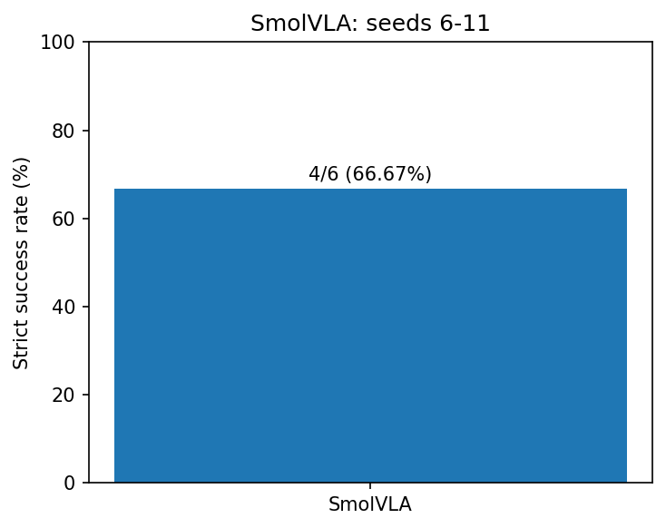
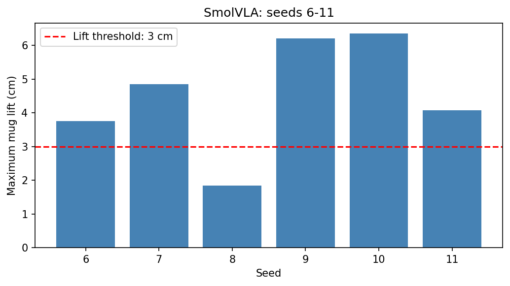
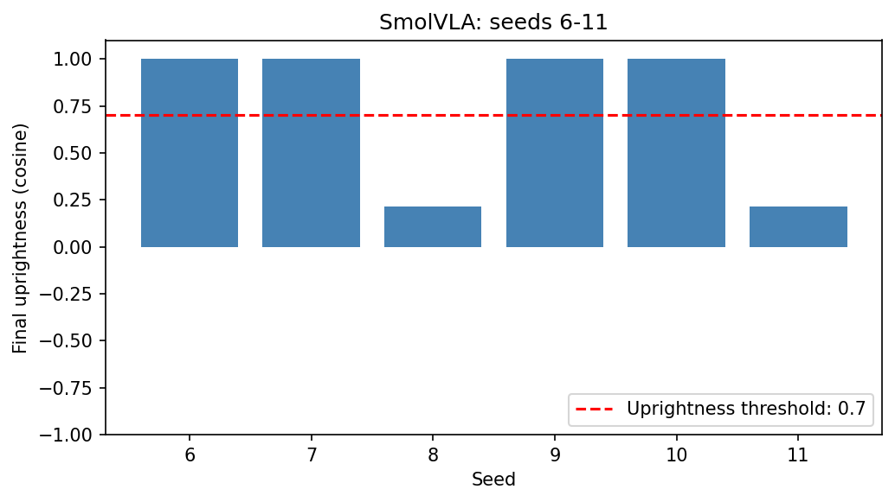

# pnp-policy-eval

基于 MuJoCo 的机械臂抓放策略评测项目，面向 ACT、SmolVLA 和 Pi0，关注任务是否满足物理成功条件，以及实验结果能否复查。

项目针对课程原始流程中的成功判定、随机性和输入语义问题，整理配置、代码、测试与实验记录。
目前已保存 SmolVLA 评测与重构对比记录，并完成 ACT 状态输入修复及受限闭环检查；ACT 在已记录的单杯、双杯原基线试跑中尚未成功，Pi0 尚未完成实际验证。

首次阅读可先运行轻量检查，再查看实验结果与证据；完整闭环仍依赖外部仿真资源、数据及权重。

## 当前进展

| 项目 | 当前状态 |
|---|---|
| 配置管理 | 已将模型、路径、seed 和评测预算等设置集中到 YAML |
| 成功判定 | 已拆出独立模块，并加入正常情况及边界测试 |
| 状态输入 | 已按配置区分关节角和末端位姿读取，并加入分支及异常测试 |
| SmolVLA | 已保存评测与重构对比记录；seed 6～11 的前后结果中，排除耗时和视频路径后，17 个字段一致 |
| ACT | 已完成输入与动作接口检查；原演示离线预测总体接近演示，但 seed 6 的单杯、双杯各一次名义 120 秒原基线试跑均未成功 |
| Pi0 | 已有加载分支，尚未完成实际加载与闭环验证 |

ACT 接入后尚未运行新的 SmolVLA 真实闭环回归。
上述结果只适用于已检查的条件，不代表整体成功率或泛化能力。

证据入口：[DAY18 验证记录](docs/day18-evidence.md)、
[后续 ACT 单杯诊断](docs/act-singlecup-debug.md)、
[阶段复盘](notes/week01.md)。

## 项目结构

```text
pnp-policy-eval/
├── configs/                 # 实验配置：模型、路径、seed、运行预算等
├── src/                     # 项目的主要实现
│   ├── evaluate.py          # 闭环评测入口，读取配置并运行策略
│   ├── success.py           # 成功判定与指标计算
│   └── single_cup_env.py    # 单杯场景初始化适配
├── tests/                   # 检查成功判定、状态读取及诊断工具
├── tools/                   # 轨迹记录、预测检查、分析和绘图脚本
├── results/                 # 保存的小型实验结果、指标及测试记录
├── docs/                    # 问题发现、实验分析与证据索引
├── notes/                   # 阶段复盘与学习记录
└── README.md                # 项目介绍与使用入口
```

完整仿真资源、数据集、模型权重和视频位于本机外部目录，
本仓库主要保存代码、配置、文档和小型结果。

## 运行前置条件

### 只运行单元测试

需要 Python，以及 pytest、NumPy、PyTorch。
当前单元测试不需要真实启动 MuJoCo，也不需要模型权重和数据集。

### 运行真实闭环评测

需要先准备：

- 已配置好的课程仿真环境，包括 MuJoCo、匹配的 LeRobot 代码及相关依赖。
- 上游仿真工程中的 `mujoco_env/`、场景 XML 及其引用的资源。
- 对应的数据集与模型权重，并确认状态含义、归一化统计与权重匹配。
- 与配置中 `policy.device` 匹配的计算环境；当前配置使用 `cuda`。

评测还会使用 PyYAML 和 Pillow；单杯演示起点读取需要 pandas 及 Parquet 读取依赖（本机使用 pyarrow）。
视频写出使用 imageio + imageio-ffmpeg，或回退到 OpenCV。

本机参考环境为 Python 3.10.21、PyTorch 2.7.0+cu128、
MuJoCo 3.1.6。以上是环境记录，不是完整安装清单。
本仓库暂未提供完整的依赖锁定文件。

### 检查配置中的路径

运行前，根据自己的文件位置修改 YAML：

| 配置项 | 指向什么 |
|---|---|
| `paths.project_root` | 上游仿真工程根目录 |
| `dataset.root` | 本次模型对应的数据集目录 |
| `policy.path` | 模型权重目录 |
| `env.xml` | 相对于上游工程根目录的场景文件 |
| `paths.output_root` | 本次实验的输出目录，重跑时使用新目录 |

配置中的 `D:/lerobot-mujoco-tutorial` 是本机示例路径，
其他机器需要修改。运行命令应在本仓库根目录执行。

## 在 VS Code 中检查与运行

### 1. 打开项目

在 VS Code 中选择“文件 → 打开文件夹”，
打开 `pnp-policy-eval` 项目根目录。

左侧应能看到 `src`、`configs`、`tests` 和 `README.md`。

### 2. 选择 Python 环境

按 `Ctrl+Shift+P`，搜索并选择：

`Python: Select Interpreter`（由 VS Code 的 Python 扩展提供）。

本机使用：

`D:\miniconda3-1\envs\py310\python.exe`

其他机器选择已安装项目依赖的 Python 环境。

### 3. 打开终端并确认环境

选择“终端 → 新建终端”，运行：

```powershell
python -c "import sys; print(sys.executable)"
```

本机预期输出：

```text
D:\miniconda3-1\envs\py310\python.exe
```

若输出路径不符，先切换终端环境；也可以使用解释器完整路径运行。
后续命令均在本仓库根目录的这个终端中执行。

### 4. 运行单元测试

```powershell
python -m pytest -q
```

2026-10-21 本机检查为 37 项通过。
测试通过表示已覆盖的软件检查符合预期，不代表机器人任务成功。

### 5. 比较已有结果

```powershell
python -m src.nondeterminism_check `
  results/smolvla_baseline_seeds6-11.jsonl `
  results/smolvla_refactor_seeds6-11.jsonl `
  results/smolvla_d15_seeds6-11.jsonl
```

预期：seed 6～11 均显示 `[OK]`，合计 6 一致、0 有差异。
上述续行写法适用于 PowerShell；其他终端可将命令合并为一行。

比较默认排除运行耗时和视频路径，只读取已有记录，不重新运行模型或仿真。
工具不会自动核对权重和配置来源，不能把不同模型的真实差异当作随机性问题。

### 6. 按需运行真实闭环

先完成“运行前置条件”中的环境、资源和路径检查。
在 VS Code 左侧资源管理器中复制配置，为新实验单独保留配置文件；
修改其中的 `paths.output_root`，使用新的输出目录，不覆盖历史证据。

ACT 双杯示例：复制 `configs/act_y.yaml`，命名为 `configs/act_y_run.yaml`。
核对并修改新配置后执行：

```powershell
python -m src.evaluate --config configs/act_y_run.yaml
```

ACT 单杯示例：复制 `configs/act_y_singlecup_demo_120s.yaml`，
命名为 `configs/act_y_singlecup_run.yaml`。
核对并修改新配置后，使用专用初始化入口：

```powershell
python tools/trace_rollout.py --config configs/act_y_singlecup_run.yaml --single-cup-demo
```

单杯配置需要 `--single-cup-demo` 启用环境适配，不能直接套用普通评测入口。
上述新配置需要先自行创建，仓库没有预置它们。

两个 ACT 示例的结果均保存在各自输出目录下的 `act_closed_loop/results.jsonl`。
视频保存成功时，同目录还会生成 MP4；单杯轨迹入口还会生成
`trajectory_seed6.jsonl`、`trace_check.json` 等诊断记录。

程序正常结束不代表任务成功，应查看 `physical_success` 及相关指标。
这些仿真命令供按需复现，阅读文档和检查已有证据不要求立即重跑。

## 实验结果与局限

### 已保存的结果

| 检查条件 | 结果 | 证据 |
|---|---|---|
| SmolVLA 重构前后对比 | seed 6～11，排除耗时和视频路径后，17 个字段一致 | [修改前](results/smolvla_baseline_seeds6-11.jsonl)、[配置外置后](results/smolvla_refactor_seeds6-11.jsonl)、[判定拆分后](results/smolvla_d15_seeds6-11.jsonl) |
| ACT 原演示离线预测，2259 帧 | 逐帧首动作的六关节平均绝对误差约 0.561°；个别单关节误差可达约 30° | [预测指标](results/act_y_d18_training_fit_metrics.json) |
| ACT 双杯，seed 6，名义 120 秒 | 严格判定失败，杯子最大抬高约 0.0013 毫米 | [双杯结果](results/act_y_d18_double_120s_seed6.jsonl) |
| ACT 单杯、演示物体起点，seed 6，名义 120 秒 | 严格判定失败，杯子最大抬高约 0.536 毫米 | [单杯结果](results/act_y_d18_singlecup_demo_120s_seed6.jsonl) |
| 后续演示命令重放，不调用模型 | 能抓取和搬运，最大抬高约 18.6 厘米；最终杯子倾斜，严格判定仍失败 | [追加诊断](docs/act-singlecup-debug.md) |

120 秒指 20 Hz 下最多执行 2400 条动作的名义预算，
不是程序的实际运行耗时。

严格成功判定包含抬升、直立、松爪和稳定放置等条件，
仅移动到盘子附近不算完成任务。

### 当前局限

- 单杯、双杯原基线各只有 seed 6 的一次记录，不能估计整体成功率或泛化能力。
- 离线预测使用演示中的图片和状态，不能代替真实闭环验证。
- 单杯基线同时改变了物体数量和摆放，且未恢复完整历史仿真状态，不能单独归因蓝杯。
- 后续发现了局部朝向敏感性和重复观测对应不同标签的线索，但尚未确定唯一失败原因；推理调整和两次微调也未使闭环成功。
- 软件测试通过不代表机器人任务成功；ACT 接入后尚未进行新的 SmolVLA 真实闭环回归。
- Pi0 尚未完成实际加载与闭环验证。
- 本仓库尚未包含完整依赖锁定文件、数据集和权重，不能仅克隆仓库就复现完整闭环；本机记录一致也不保证跨机器逐位一致。

### SmolVLA 六条评测记录的图表分析

本次分析使用已有的 seed 6～11 评测记录，通过绘图检查本批成功率、最大抬升高度和最终直立度，没有重新运行模型或仿真。

本批 SmolVLA 评测包含 seed 6～11，共 6 条记录。其中 4 次严格成功、2 次失败，本批成功率为 66.67%，失败记录为 seed 8 和 seed 11。



最大抬升高度图显示，seed 8 的最大抬升约为 1.85 厘米，没有达到 3 厘米的要求；seed 11 约为 4.07 厘米，达到了抬升高度要求，但仍未严格成功。

 

最终直立度图显示，seed 8 和 seed 11 的最终直立度都约为 0.21，低于 0.7 的要求，其余四条记录均接近 1。 



这些结果说明，达到抬升高度要求并不足以保证任务成功，还需要满足直立等其他条件。上述结论仅针对这 6 条记录，不能据此确定模型的整体成功率，也不能确定失败的根本原因。

## 问题发现与诊断记录

- [动作标签语义](docs/finding-01-action-semantics.md)：说明特定坏数据中 `action` 记录实测关节角而非命令目标的问题，附 FK 检查工具和适用边界；不能据此认定当前 ACT 失败仍是同一个旧问题。
- [评测随机性](docs/finding-02-nondeterminism.md)：说明场景 seed 与模型随机性控制的区别，附重复结果比较工具和本机验证范围。
- [ACT 单杯追加诊断](docs/act-singlecup-debug.md)：记录命令重放、朝向敏感性、重复等待观测，以及未成功的推理调整和微调尝试。

## 致谢

`src/evaluate.py` 与 `src/video_io.py` 改编自
[datawhalechina/every-embodied](https://github.com/datawhalechina/every-embodied)
「04-AMD-ROCm策略复刻专题」的 `code/run_closed_loop.py` 和 `code/video_io.py`。
原文以 [CC BY 4.0](https://creativecommons.org/licenses/by/4.0/) 发布，
Copyright (c) Datawhale and contributors。

本项目对其的改动：配置外置到 `configs/default.yaml`；移除模块级 `argparse` 与 `os.chdir`；
`state_type` / `action_type` / 状态切片长度参数化；视频写出保留在 `src/video_io.py`。

`src/single_cup_env.py` 的初始化适配同样依据该教程的 `mujoco_env/y_env2.py`，
沿用原控制与判定，仅支持单杯及演示记录的物体起点。
运行步骤见“在 VS Code 中检查与运行”。
